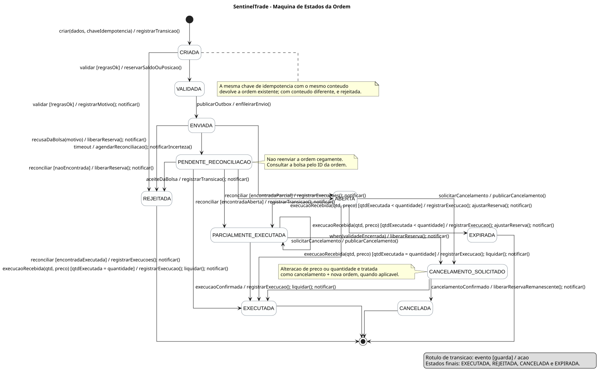

# Modelagem de Estados da Ordem — SentinelTrade

> **Base:** `requisitos.md`, especialmente o ciclo de vida da ordem e RF-12 a RF-21.
>
> **Referência metodológica:** capítulo 9, *Modelagem de estados*.
>
> **Arquivo do diagrama (UML-as-a-Code):** `./plantuml/estados-ordem.puml`.

---

## 1. Diagrama

O diagrama de estados está especificado em PlantUML: [estados-ordem.puml](./plantuml/estados-ordem.puml).

Ele descreve o ciclo de vida de uma instância da classe `Ordem`. Essa classe foi escolhida porque possui estados finitos conhecidos e porque as operações permitidas - validar, enviar, executar, cancelar e reconciliar - dependem diretamente de seu estado atual.



---

## 2. Notação utilizada

Cada transição segue a forma UML abaixo:

```text
evento(parametros) [guarda] / acao
```

| Elemento | Significado no SentinelTrade |
|---|---|
| Evento | Fato que pode mudar a ordem de estado, como `aceiteDaBolsa`, `timeout` ou `solicitarCancelamento`. |
| Guarda | Condição lógica necessária para a transição, como `[regrasOk]` ou `[naoEncontrada]`. |
| Ação | Efeito executado somente quando a transição ocorre, como reservar/liberar saldo, registrar execução ou notificar. |
| Estado inicial | Criação da ordem, que a coloca em `CRIADA`. |
| Estado final | Encerramento do ciclo em `EXECUTADA`, `REJEITADA`, `CANCELADA` ou `EXPIRADA`. |

---

## 3. Estados da ordem

| Estado | Significado | Como é alcançado |
|---|---|---|
| `CRIADA` | Ordem registrada, ainda não aprovada para transmissão. | Solicitação válida em formato e com ID/chave gerados. |
| `VALIDADA` | Regras pré-negociação aprovadas e recurso reservado. | Saldo/posição, limites, ativo, mercado, lote, tick e suitability atendidos. |
| `ENVIADA` | Solicitação publicada para transmissão e aguardando resultado da bolsa. | Ordem validada entra na outbox/fila. |
| `ABERTA` | Bolsa aceitou a ordem; ela pode executar, expirar ou receber pedido de cancelamento. | Aceite da bolsa. |
| `PENDENTE_RECONCILIACAO` | O sistema não sabe se a bolsa recebeu/processou a ordem. | Timeout sem resposta conclusiva. |
| `PARCIALMENTE_EXECUTADA` | Parte da quantidade foi executada; ainda resta quantidade em aberto. | Execução parcial recebida. |
| `CANCELAMENTO_SOLICITADO` | Pedido de cancelamento enviado, sem confirmação final. | Solicitação sobre ordem aberta ou parcial. |
| `EXECUTADA` | Toda a quantidade foi executada. | Execução total, inclusive se ocorreu antes de a bolsa efetivar o cancelamento. |
| `REJEITADA` | Validação local, bolsa ou reconciliação recusou a ordem. | Falha de validação, recusa externa ou inexistência confirmada pela bolsa. |
| `CANCELADA` | A bolsa confirmou o cancelamento. | Confirmação recebida após o pedido. |
| `EXPIRADA` | Ordem aberta alcançou o limite de validade. | Evento temporal `when(validadeEncerrada)`. |

---

## 4. Fluxos principais

### 4.1 Criação, validação e envio

1. A ordem é criada com dados, número sequencial e chave de idempotência.
2. O evento `validar` leva a `VALIDADA` apenas com a guarda `[regrasOk]`; a ação reserva saldo ou posição.
3. Se alguma regra falhar, a mesma validação leva a `REJEITADA`, com motivo legível e notificação, sem reserva.
4. A ordem validada é registrada na outbox e entra em `ENVIADA`.
5. O aceite da bolsa leva a `ABERTA`; uma recusa libera a reserva e leva a `REJEITADA`.

### 4.2 Execução e cancelamento

1. Uma execução com quantidade total ainda menor que a quantidade solicitada leva `ABERTA` a `PARCIALMENTE_EXECUTADA`.
2. Enquanto ainda houver remanescente, novas execuções usam a transição reflexiva de `PARCIALMENTE_EXECUTADA` para ela própria.
3. A guarda `[qtdExecutada = quantidade]` encerra a execução em `EXECUTADA`.
4. De `ABERTA` ou `PARCIALMENTE_EXECUTADA`, o investidor pode solicitar cancelamento. A ordem passa a `CANCELAMENTO_SOLICITADO`, nunca diretamente a `CANCELADA`.
5. A confirmação da bolsa cancela e libera somente a reserva remanescente. Se a execução vencer a corrida, o estado final é `EXECUTADA`.

### 4.3 Timeout e reconciliação

Após `timeout`, a ordem chega a `PENDENTE_RECONCILIACAO`. Não existe transição de reenvio automático: reenviar uma ordem cuja situação é desconhecida pode duplicar uma negociação. O reconciliador consulta a bolsa pelo ID da ordem e, conforme a resposta, a leva a `ABERTA`, `PARCIALMENTE_EXECUTADA`, `EXECUTADA` ou `REJEITADA`.

Essa decisão é central para RF-21 e RNF-RES-02/03: em caso de incerteza, o sistema prefere descobrir o estado real a executar novamente uma operação que pode já ter sido aceita.

---

## 5. Regras de negócio preservadas

| Regra | Representação no diagrama |
|---|---|
| Nenhuma ordem segue sem validação | A única transição de `CRIADA` para envio passa antes por `VALIDADA`. |
| Recurso não pode ser usado duas vezes | `reservarSaldoOuPosicao()` ocorre ao entrar em `VALIDADA`; liberações são explícitas nos finais que não executam a ordem. |
| Cancelamento precisa de confirmação | Estado intermediário `CANCELAMENTO_SOLICITADO`. |
| Ordem parcial continua acompanhável | Estado próprio e transição reflexiva para execuções adicionais. |
| Timeout não significa rejeição | Estado próprio `PENDENTE_RECONCILIACAO` e resolução posterior. |
| Toda mudança relevante é transparente | Ações de notificação estão nas transições de retorno, execução, rejeição, cancelamento e expiração. |
| Alteração preserva auditoria | Quando exigido pela bolsa, alteração é cancelamento mais criação de nova ordem; a ordem original conserva sua linha do tempo. |

---

## 6. Rastreabilidade

| Requisito | Elementos do diagrama |
|---|---|
| RF-12 | `CRIADA`, `VALIDADA`, `ENVIADA`, validade e número/chave indicados na criação. |
| RF-14 e RF-16 | Guarda `[regrasOk]` e ação `reservarSaldoOuPosicao()`. |
| RF-17 e RF-18 | `CANCELAMENTO_SOLICITADO`, `CANCELADA` e nota sobre alteração por cancelamento + nova ordem. |
| RF-19 | Estados explícitos, execuções parciais e ações de notificação. |
| RF-20 | Nota sobre chave de idempotência e retorno da ordem existente. |
| RF-21 | `PENDENTE_RECONCILIACAO` e todas as transições disparadas por `reconciliar`. |
| RF-23 | Ações `notificar()` nas transições relevantes. |
| RNF-RES-02, RNF-RES-03 e RNF-RES-07 | Timeout sem reenvio cego, identificação da ordem e transições validadas. |
