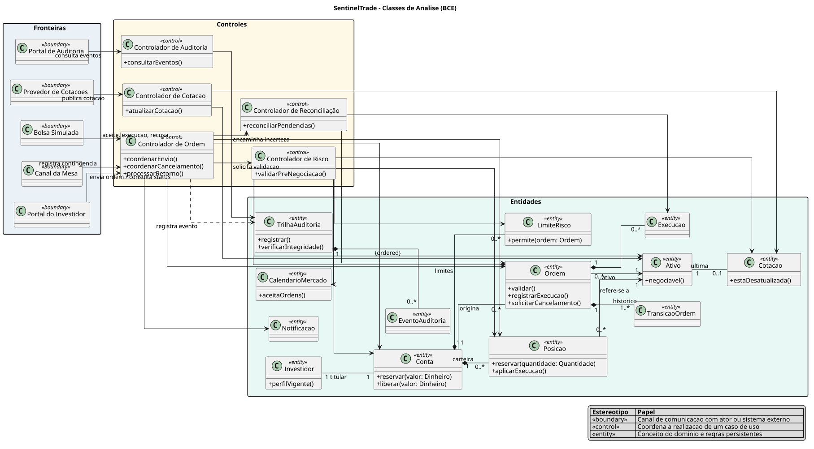

# Modelo de Classes de Análise — SentinelTrade

> **Base:** `requisitos.md` e `modelo-casos-de-uso.md`.
>
> **Referência metodológica:** capítulo 5, *Modelagem de classes de análise*.
>
> **Arquivo do diagrama (UML-as-a-Code):** `./plantuml/classes-analise.puml`.

---

## 1. Diagrama

O diagrama de classes de análise está especificado em PlantUML: [classes-analise.puml](./plantuml/classes-analise.puml).

Ele usa a categorização **BCE** (*Boundary, Control, Entity*) para mostrar a colaboração dos objetos na realização dos casos de uso críticos do SentinelTrade.

| Estereótipo | Papel no modelo |
|---|---|
| `«boundary»` | Ponto de comunicação entre o SentinelTrade e um ator humano ou sistema externo. |
| `«control»` | Coordena a realização de um caso de uso, sem concentrar regras duradouras do domínio. |
| `«entity»` | Representa informação e regras de negócio persistentes do domínio. |

---

## 2. Fronteiras

As classes de fronteira representam o canal de contato com o ambiente. Elas recebem estímulos, apresentam resultados e encaminham a solicitação ao controle; não executam validação financeira nem transição de estado por conta própria.

| Classe | Ator ou sistema relacionado | Responsabilidade |
|---|---|---|
| `Portal do Investidor` | Investidor | Receber solicitações de ordem e consulta de status. |
| `Canal da Mesa` | Operador de mesa | Registrar ordem de contingência em nome do investidor. |
| `Bolsa Simulada` | Bolsa simulada | Receber envio e devolver aceite, execução ou recusa. |
| `Provedor de Cotações` | Provedor de cotações | Publicar atualizações de preço. |
| `Portal de Auditoria` | Auditor | Consultar eventos de auditoria. |

Os nomes descrevem o canal de comunicação, e não uma ação. Assim, por exemplo, `Portal do Investidor` pode ser realizado futuramente por web e aplicativo sem mudar o modelo de análise.

---

## 3. Controles

Cada controle coordena um conjunto coeso de cenários dos casos de uso. Ele decide a sequência de colaboração entre entidades e fronteiras, mas a regra financeira continua na entidade que possui os dados necessários.

| Classe | Casos de uso | Responsabilidade |
|---|---|---|
| `Controlador de Ordem` | UC06, UC08, UC14, UC19, UC25 | Coordenar envio, cancelamento e processamento do retorno da bolsa. |
| `Controlador de Risco` | UC13 | Coordenar validação de saldo, posição, risco, ativo, cotação e mercado. |
| `Controlador de Cotação` | UC04, UC17 | Atualizar a última cotação do ativo. |
| `Controlador de Reconciliação` | UC26 | Consultar ordens incertas na bolsa e resolver a divergência. |
| `Controlador de Auditoria` | UC22 | Coordenar consulta e verificação de eventos auditáveis. |

O controle de reconciliação é separado porque o timeout não autoriza reenviar a ordem. Seu propósito é consultar a bolsa pelo identificador da ordem e determinar o estado real, atendendo RF-21 e RNF-RES-02.

---

## 4. Entidades e responsabilidades

### 4.1 Conta, risco e mercado

| Classe | Responsabilidade |
|---|---|
| `Investidor` | Titular da conta e detentor do perfil de suitability. |
| `Conta` | Manter saldo disponível e bloqueado; reservar e liberar recursos. |
| `Posicao` | Manter quantidade total e bloqueada de um ativo. |
| `LimiteRisco` | Decidir se uma ordem respeita os limites aplicáveis. |
| `Ativo` | Informar se o ativo está negociável. |
| `Cotacao` | Informar se a cotação conhecida está desatualizada. |
| `CalendarioMercado` | Informar se a fase de mercado aceita a ordem. |

### 4.2 Ordem, comunicação e auditoria

| Classe | Responsabilidade |
|---|---|
| `Ordem` | Registrar os dados, aplicar transições permitidas e coordenar seu próprio ciclo de vida. |
| `Execucao` | Preservar cada execução total ou parcial recebida da bolsa. |
| `TransicaoOrdem` | Formar a linha do tempo de mudanças de estado, motivo e horário. |
| `Notificacao` | Representar comunicação enviada ao investidor. |
| `TrilhaAuditoria` | Acrescentar eventos e verificar a integridade da cadeia de hashes. |
| `EventoAuditoria` | Registrar autor, ação, horário, correlação, resultado e hashes de um evento imutável. |

---

## 5. Relacionamentos e multiplicidades

| Relação | Tipo | Leitura |
|---|---|---|
| `Investidor` — `Conta` | Associação 1 para 1 | Cada investidor possui uma conta, conforme a premissa do escopo. |
| `Conta` ◆— `Posicao` | Composição 1 para 0..* | A carteira é composta pelas posições da conta. |
| `Conta` ◆— `LimiteRisco` | Composição 1 para 0..* | Limites pertencem à conta e são usados na pré-negociação. |
| `Conta` — `Ordem` | Associação 1 para 0..* | Uma conta origina muitas ordens; a ordem persiste no histórico mesmo após inativação. |
| `Ordem` → `Ativo` | Associação navegável | Toda ordem refere-se a um único ativo. |
| `Ordem` ◆— `Execucao` | Composição 1 para 0..* | Uma ordem pode possuir várias execuções parciais. |
| `Ordem` ◆— `TransicaoOrdem` | Composição 1 para 1..* | A ordem possui ao menos seu registro de criação e toda a linha do tempo posterior. |
| `TrilhaAuditoria` ◆— `EventoAuditoria` | Composição ordenada | Eventos não existem fora da trilha e permanecem na sequência em que ocorreram. |

A composição é usada somente quando a parte não tem significado fora do todo. Por isso, `Ordem` não é uma parte composta de `Conta`: requisitos de histórico e auditoria exigem conservar a ordem mesmo que a conta seja inativada.

---

## 6. Realização dos casos de uso críticos

| Caso de uso | Colaboração principal |
|---|---|
| UC06 Enviar ordem | `Portal do Investidor` → `Controlador de Ordem` → `Controlador de Risco` → `Ordem`, `Conta`, `Posicao`, `LimiteRisco`, `Ativo`, `Cotacao`, `CalendarioMercado`. |
| UC13 Validar ordem | `Controlador de Risco` consulta as entidades e devolve uma decisão para a ordem. |
| UC14 Transmitir à bolsa | `Controlador de Ordem` comunica-se com `Bolsa Simulada`; timeout é encaminhado à reconciliação. |
| UC17 Atualizar cotações | `Provedor de Cotações` → `Controlador de Cotação` → `Cotacao` e `Ativo`. |
| UC25 Processar retorno | `Bolsa Simulada` → `Controlador de Ordem` → `Ordem`, `Execucao`, `Conta`/`Posicao` e `Notificacao`. |
| UC26 Reconciliar ordens | `Controlador de Reconciliação` consulta a bolsa e atualiza `Ordem` e `Execucao`. |
| UC22 Consultar auditoria | `Portal de Auditoria` → `Controlador de Auditoria` → `TrilhaAuditoria`. |

---

## 7. Limites deste modelo

O modelo de análise descreve responsabilidades e colaboração, sem escolher HTTP, banco SQL, fila, bibliotecas, classes de repositório ou assinaturas completas. Esses detalhes aparecem no [Modelo de Classes de Projeto](./modelo-classes-projeto.md). O modelo de domínio mais amplo, incluindo identidade, MFA, sessões e preferências, permanece em `uml.md`.
