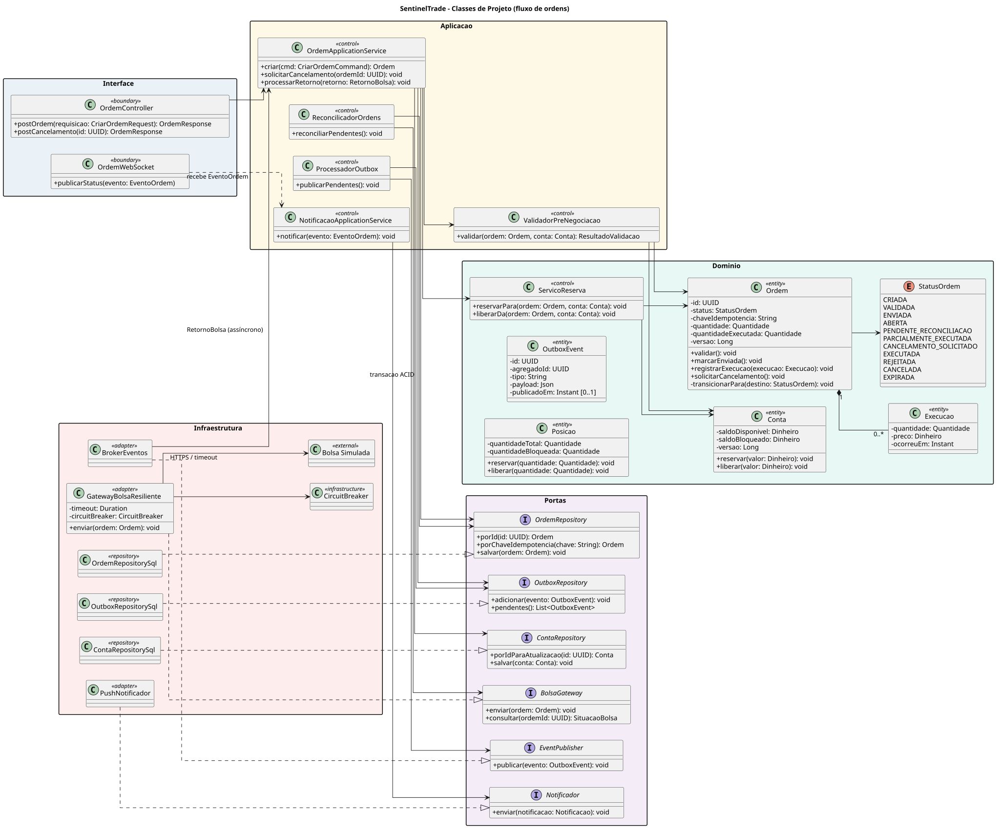

# Modelo de Classes de Projeto — SentinelTrade

> **Base:** `requisitos.md`, `modelo-casos-de-uso.md` e `modelo-classes-analise.md`.
>
> **Referência metodológica:** capítulo 8, *Modelagem de classes de projeto*.
>
> **Arquivo do diagrama (UML-as-a-Code):** `./plantuml/classes-projeto.puml`.

---

## 1. Diagrama

O diagrama de projeto está especificado em PlantUML: [classes-projeto.puml](./plantuml/classes-projeto.puml).

Ele transforma o recorte BCE de análise no desenho implementável do fluxo de ordens. Por isso, acrescenta tipos, atributos, visibilidade, operações, interfaces e adaptadores de infraestrutura.

---

## 2. Organização em camadas

| Camada | Classes principais | Responsabilidade |
|---|---|---|
| Interface | `OrdemController`, `OrdemWebSocket` | Converter HTTP/WebSocket em comandos, respostas e atualização de tela. |
| Aplicação | `OrdemApplicationService`, `ValidadorPreNegociacao`, `ProcessadorOutbox`, `ReconcilicadorOrdens` | Orquestrar os casos de uso e suas transações. |
| Domínio | `Ordem`, `Conta`, `Posicao`, `Execucao`, `ServicoReserva` | Proteger invariantes financeiros e o ciclo de vida da ordem. |
| Portas | `OrdemRepository`, `ContaRepository`, `OutboxRepository`, `BolsaGateway`, `EventPublisher`, `Notificador` | Definir contratos que o núcleo usa sem depender de tecnologia. |
| Infraestrutura | Implementações SQL, broker, push e gateway resiliente | Adaptar as portas ao banco, fila, notificações e bolsa simulada. |

A separação evita que o controlador HTTP saiba como reservar saldo ou que a entidade `Ordem` saiba como chamar a bolsa. Isso preserva coesão, reduz acoplamento e permite testar a regra de negócio com portas substituídas por dublês.

---

## 3. Classes de interface e aplicação

### 3.1 Interface

| Classe | Operações relevantes | Decisão |
|---|---|---|
| `OrdemController` | `postOrdem()` e `postCancelamento()` | Recebe requisições, faz validação de formato/autorização e delega ao serviço de aplicação. Não contém regra financeira. |
| `OrdemWebSocket` | `publicarStatus()` | Publica a mudança de estado ao investidor em até 2 s, conforme RNF-DES-03. |

### 3.2 Aplicação

| Classe | Responsabilidade |
|---|---|
| `OrdemApplicationService` | Criar ordem, solicitar cancelamento e aplicar retorno da bolsa; é o ponto de orquestração da transação de caso de uso. |
| `ValidadorPreNegociacao` | Validar saldo/posição, limites, ativo, cotação, mercado, lote, tick e suitability antes do envio. |
| `ProcessadorOutbox` | Publicar eventos que foram gravados na outbox mas ainda não chegaram à fila. |
| `ReconcilicadorOrdens` | Consultar a bolsa para resolver ordens em `PENDENTE_RECONCILIACAO`. |
| `NotificacaoApplicationService` | Selecionar e enviar a notificação produzida por um evento de ordem. |

O serviço de aplicação chama as interfaces de repositório e registra a `OutboxEvent` na mesma transação que grava a `Ordem`. Assim, uma ordem aceita não fica sem evento a publicar, atendendo RNF-RES-04.

---

## 4. Classes de domínio

### 4.1 Encapsulamento financeiro

`Ordem`, `Conta` e `Posicao` têm atributos privados (`-`) e expõem apenas operações de negócio. Não há `setSaldo()` ou `setStatus()` público.

| Classe | Atributos relevantes | Operações que preservam invariantes |
|---|---|---|
| `Ordem` | `status`, `chaveIdempotencia`, quantidade, quantidade executada e `versao` | `validar()`, `marcarEnviada()`, `registrarExecucao()`, `solicitarCancelamento()` e `transicionarPara()` privada. |
| `Conta` | saldo disponível, saldo bloqueado e `versao` | `reservar()` e `liberar()`. |
| `Posicao` | quantidade total e bloqueada | `reservar()` e `liberar()`. |
| `Execucao` | quantidade, preço e instante | Preservar cada negócio informado pela bolsa. |
| `OutboxEvent` | agregado, tipo, payload e publicação | Persistir de forma durável o evento que será entregue à fila. |

`versao` representa concorrência otimista: uma alteração sobre saldo ou ordem só é confirmada se a versão ainda for a esperada. Esse desenho impede que duas ordens concorrentes reservem o mesmo recurso, atendendo RF-16 e RNF-RES-07.

### 4.2 Serviço de reserva

`ServicoReserva` é uma classe de domínio porque coordena a reserva com base no lado da ordem: para compra, chama `Conta.reservar(valor)`; para venda, chama `Posicao.reservar(quantidade)`. A responsabilidade não fica em um controlador de interface e nem transforma a entidade `Ordem` em conhecedora da estrutura interna da carteira.

---

## 5. Portas e infraestrutura

| Porta | Adaptador previsto | Papel |
|---|---|---|
| `OrdemRepository` | `OrdemRepositorySql` | Localizar por ID ou chave de idempotência e persistir a ordem. |
| `ContaRepository` | `ContaRepositorySql` | Carregar conta para atualização e salvar a reserva. |
| `OutboxRepository` | `OutboxRepositorySql` | Armazenar e recuperar eventos não publicados. |
| `BolsaGateway` | `GatewayBolsaResiliente` | Enviar ordem e consultar sua situação externa. |
| `EventPublisher` | `BrokerEventos` | Publicar eventos assíncronos e receber retorno da bolsa. |
| `Notificador` | `PushNotificador` | Entregar a notificação no canal configurado. |

`GatewayBolsaResiliente` recebe timeout explícito e usa `CircuitBreaker`. Quando a resposta ao envio é incerta, a ordem não é reenviada às cegas: o retorno é a ida para reconciliação. Isso mantém a integridade acima da disponibilidade quando a integração falha.

---

## 6. Rastreabilidade com requisitos

| Decisão do diagrama | Requisitos |
|---|---|
| Atributos privados e métodos de negócio | RNF-SEG-04, RNF-INT-01 |
| Busca por chave de idempotência | RF-20, RNF-SEG-08, RNF-RES-03 |
| Controle de versão de `Ordem` e `Conta` | RF-16, RNF-RES-07 |
| `OutboxEvent` + `ProcessadorOutbox` + broker | RNF-RES-04, RNF-RES-06 |
| `GatewayBolsaResiliente` com timeout/disjuntor | RNF-RES-01, RNF-RES-02, RNF-RES-05 |
| `ReconcilicadorOrdens` e consulta por ID | RF-21 |
| `OrdemWebSocket` e serviço de notificação | RF-23, RNF-DES-03 |
| Interfaces entre domínio e infraestrutura | RNF-MAN-01 |

---

## 7. Limites do diagrama

O diagrama detalha o caminho de maior risco: recebimento, validação, reserva, publicação, retorno, reconciliação e notificação de uma ordem. MFA, cadastro, sessões, cotações, preferências e auditoria seguem a mesma divisão arquitetural, mas não foram expandidos aqui para manter a leitura do fluxo crítico. Seus conceitos de domínio são registrados no modelo de análise e em `uml.md`.
