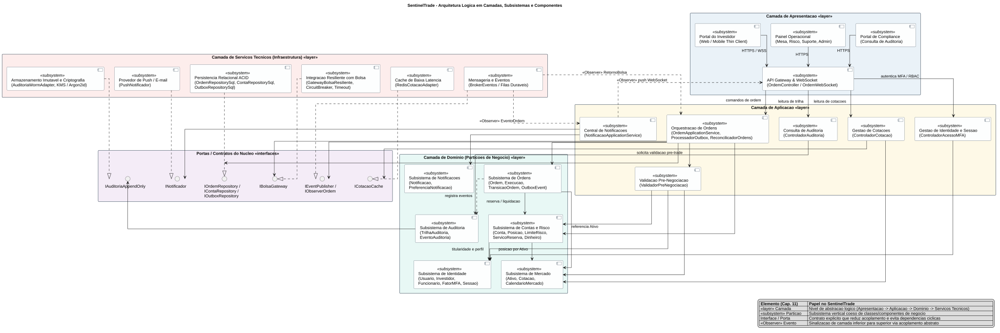
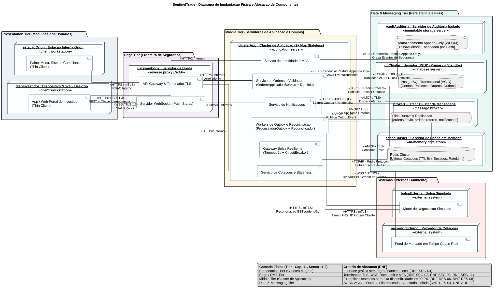

# Arquitetura do Sistema — SentinelTrade

> **Base:** `requisitos.md`, `uml-casos-de-uso.md`, `modelo-classes-analise.md` e `modelo-classes-projeto.md`.
>
> **Referência metodológica:** BEZERRA, Eduardo. *Princípios de Análise e Projeto de Sistemas com UML*, cap. 11, *Arquitetura do sistema*.
>
> **Arquivos dos diagramas (UML-as-a-Code):**
> - Arquitetura Lógica (Camadas, Subsistemas e Componentes): `../extra-e-refs-aula/plantuml/arquitetura-sistema.puml` (`../extra-e-refs-aula/assets/arquitetura-sistema.svg`)
> - Implantação Física e Alocação de Componentes: `../extra-e-refs-aula/plantuml/arquitetura-implantacao.puml` (`../extra-e-refs-aula/assets/arquitetura-implantacao.svg`)

---

## 1. Visão Geral do Projeto Arquitetural

Segundo o capítulo 11 (Bezerra), a arquitetura de software define a estrutura organizacional de um sistema orientado a objetos por meio de sua decomposição recursiva em **subsistemas** e **componentes** que interagem através de **interfaces**, atendendo diretamente aos **requisitos não funcionais (RNFs)**.

O projeto arquitetural do SentinelTrade contempla as duas dimensões exigidas na metodologia:

1. **Arquitetura Lógica (Seção 11.1):** organização das classes e componentes em **camadas horizontais** (níveis de abstração) e **partições verticais** (`«subsystem»`), mantendo alta coesão interna, baixo acoplamento entre subsistemas e ausência de dependências cíclicas.
2. **Implantação Física e Componentes (Seção 11.2):** alocação das camadas lógicas e dos componentes de tempo de execução aos **nós físicos de processamento** (*multi-tier*), considerando desempenho, redundância (sem ponto único de falha), isolamento de segurança e resiliência nas integrações externas.

---

## 2. Arquitetura Lógica — Camadas, Partições e Componentes

O diagrama abaixo representa a decomposição do SentinelTrade nas quatro camadas lógicas clássicas descritas por Bezerra (Seção 11.1.1, Figura 11-4) — **Apresentação**, **Aplicação**, **Domínio** e **Serviços Técnicos** — mediadas por **Portas (Interfaces)** que desacoplam o núcleo financeiro da infraestrutura.

- Especificação PlantUML: [arquitetura-sistema.puml](../extra-e-refs-aula/plantuml/arquitetura-sistema.puml)

### 2.1 Camadas Lógicas (Seção 11.1.1)

| Camada Lógica | Papel Arquitetural | Subsistemas / Componentes Alocados |
|---|---|---|
| **Apresentação** (`«layer»`) | Visualização de dados, interação com usuários humanos (*thin clients*) e fronteira de entrada HTTP/WebSocket. Não contém regra financeira. | `Portal do Investidor`, `Painel Operacional (Mesa/Risco/Suporte/Admin)`, `Portal de Compliance`, `API Gateway & WebSocket`. |
| **Aplicação** (`«layer»`) | Intermediária entre a apresentação e o domínio; coordena o fluxo dos casos de uso, transações e chamadas às portas. | `Orquestração de Ordens`, `Validação Pré-Negociação`, `Gestão de Cotações`, `Gestão de Identidade e Sessão`, `Central de Notificações`, `Consulta de Auditoria`. |
| **Domínio** (`«layer»`) | Núcleo da lógica de negócio; guarda as entidades, agregados e invariantes financeiras independentes de tecnologia. | Decomposta verticalmente em **6 partições (`«subsystem»`)** detalhadas na seção 2.2. |
| **Serviços Técnicos / Infraestrutura** (`«layer»`) | Serviços genéricos de persistência ACID, cache, mensageria, criptografia, auditoria imutável e comunicação externa. | `Persistência Relacional ACID`, `Integração Resiliente com Bolsa`, `Cache de Baixa Latência`, `Mensageria e Eventos`, `Provedor de Push/E-mail`, `Armazenamento Imutável e Criptografia`. |

### 2.2 Partições Verticais da Camada de Domínio (`«subsystem»`)

Seguindo o critério da Seção 11.1 (agrupar classes em torno das abstrações centrais do modelo de domínio, maximizando a coesão interna e minimizando associações entre subsistemas), a camada de domínio é dividida em seis partições acíclicas:

| Subsistema (`«subsystem»`) | Classe Central e Agregados | Responsabilidade Principal |
|---|---|---|
| **Subsistema de Ordens** | `Ordem`, `Execucao`, `TransicaoOrdem`, `AceiteForaPerfil`, `OutboxEvent`, `StatusOrdem` | Máquina de estados da ordem, chave de idempotência, histórico de transições e execuções parciais/totais. |
| **Subsistema de Contas e Risco** | `Conta`, `Posicao`, `LimiteRisco`, `ServicoReserva`, `Dinheiro` | Reserva e liberação atômica de saldo/posição, cálculo de preço médio e verificação de limites operacionais. |
| **Subsistema de Mercado** | `Ativo`, `Cotacao`, `CalendarioMercado` | Regras de negociabilidade, lote padrão, *tick* de preço, frescor da cotação (*staleness*) e fases do pregão. |
| **Subsistema de Identidade** | `Usuario`, `Investidor`, `Funcionario`, `FatorMFA`, `Sessao` | Credenciais com hash adaptativo, segundo fator (MFA), perfil de *suitability* e segregação de funções (RBAC). |
| **Subsistema de Notificações** | `Notificacao`, `PreferenciaNotificacao` | Regras de envio de alertas de ordem e obrigatoriedade de notificações de segurança. |
| **Subsistema de Auditoria** | `TrilhaAuditoria`, `EventoAuditoria` | Registro *append-only* e verificação de integridade por cadeia de hashes. |

### 2.3 Princípios e Padrões Arquiteturais na Visão Lógica

- **Eliminação de dependências cíclicas (Seção 11.1):** O grafo de dependências entre partições é estritamente acíclico (`Ordens` → `Contas e Risco` → `Mercado` / `Identidade`, e todos → `Auditoria`). Nenhuma partição depende de `Ordens`.
- **Padrão *Façade* (Seção 11.1.1):** Os serviços da camada de Aplicação (`OrdemApplicationService`, `ValidadorPreNegociacao`, etc.) atuam como fachadas coesas para os subsistemas de domínio.
- **Padrão *Observer* e Acoplamento Abstrato (Seção 11.1.1, p. 322):** As camadas superiores dependem das inferiores (ou de contratos/Portas). Quando a camada de Serviços Técnicos precisa sinalizar um evento assíncrono às camadas superiores — como a chegada de uma execução da bolsa no `BrokerEventos` ou o disparo de atualização para o `OrdemWebSocket` — utiliza-se o padrão *Observer* sobre interfaces (`IEventPublisher` / `IObserverOrdem`), evitando que a infraestrutura dependa concretamente da apresentação.

---

## 3. Implantação Física e Alocação de Componentes

Conforme a Seção 11.2, sistemas distribuídos de alta criticidade exigem um **modelo de implementação** que mapeie os componentes de execução aos nós físicos (`node`) e especifique os protocolos de comunicação nas conexões.

- Especificação PlantUML: [arquitetura-implantacao.puml](../extra-e-refs-aula/plantuml/arquitetura-implantacao.puml)

### 3.1 Alocação em Camadas Físicas (*Multi-Tier Cliente-Servidor* — Seção 11.2.1)

| Camada Física (*Tier*) | Nó Físico (`node`) | Componentes Alocados | Protocolos de Conexão |
|---|---|---|---|
| **Presentation Tier** (*Thin Clients*) | `dispInvestidor` (Mobile/Desktop) e `estacaoOrion` (Estação Interna) | `App / Web Portal do Investidor` e `Painel Mesa, Risco e Compliance`. A lógica de negócio permanece 100% no servidor (cliente magro). | `«HTTPS / TLS 1.3»` (REST) e `«WSS / TLS 1.3»` (WebSocket). |
| **Edge / DMZ Tier** | `gatewayEdge : Servidor de Borda` | `API Gateway & Terminador TLS` e `Servidor WebSocket`. | `«HTTP/2 Interno»` e `«Pub/Sub Interno»` para o cluster de aplicação. |
| **Middle Tier** (Processamento) | `clusterApp : Cluster de Aplicação (2+ Nós Stateless)` | `Serviço de Identidade e MFA`, `Serviço de Ordens e Validação`, `Serviço de Cotações`, `Serviço de Notificações`, `Workers de Outbox e Reconciliação`, `Gateway Bolsa Resiliente`. | `«TCP/IP - JDBC/SQL»`, `«Redis Protocol»`, `«AMQP / TLS»` e `«HTTPS / mTLS»`. |
| **Data & Messaging Tier** | `dbCluster` (PostgreSQL Primary+Standby), `cacheCluster` (Redis), `brokerCluster` (Filas) e `vaultAuditoria` (WORM) | Banco transacional ACID, cache em memória com TTL de 5 s, filas duráveis replicadas e armazenamento imutável de auditoria. | Conexões internas segregadas por rede e credenciais mínimas. |
| **Sistemas Externos** | `bolsaExterna : Bolsa Simulada` e `provedorExterno : Provedor de Cotações` | `Motor de Negociação Simulado` e `Feed de Mercado`. | `«HTTPS / mTLS»` (*timeout* = 2 s) e `«WSS / HTTPS»` (*timeout* = 1 s). |

### 3.2 Fatores de Alocação Considerados (Seção 11.2.2)

Seguindo os critérios de alocação de componentes listados por Bezerra nas páginas 330–331:

1. **Tempo de resposta e Carga computacional (RNF-DES-01, RNF-DES-02):**
   - O `Serviço de Ordens e Validação` consulta o frescor da cotação diretamente no `cacheCluster` (Redis em memória, atualização ≤ 1 s e *staleness* > 5 s) e executa a reserva atômica no `dbCluster` na mesma rede local interna, cumprindo a meta de p95 ≤ 300 ms até `VALIDADA`.
   - O envio externo à bolsa é desacoplado por `Outbox` + `brokerCluster`, impedindo que a latência da rede externa bloqueie threads de atendimento ao investidor.
2. **Redundância e Tolerância a falhas (RNF-RES-06, RNF-RES-08, RNF-ESC-01):**
   - Os componentes da *Middle Tier* são *stateless* e executam em **2 ou mais nós replicados**, permitindo escalonamento horizontal (até 5× nos picos de abertura e fechamento do pregão) e *failover* imediato.
   - O banco de dados possui réplica *Standby* com *failover* automático e o broker mantém filas espelhadas (RPO = 0 para ordens confirmadas).
3. **Segurança e Isolamento de Auditoria (RNF-AUD-01, RNF-AUD-02, RNF-SEG-10):**
   - A trilha de auditoria é alocada em um nó físico distinto (`vaultAuditoria`), com armazenamento *Append-Only* (WORM) e credenciais restritas que permitem apenas inserção e leitura pelo perfil `AUDITOR`, impedindo que administradores ou serviços de negócio apaguem ou adulterem registros.

---

## 4. Rastreabilidade Arquitetura × Requisitos Não Funcionais

| Decisão Arquitetural | Requisitos Atendidos |
|---|---|
| Cliente magro (*thin client*) + validação e invariantes no servidor | RNF-SEG-04, RNF-SEG-05 |
| `gatewayEdge` com TLS 1.3, MFA, RBAC e *rate limiting* | RF-03, RF-05, RNF-SEG-02, RNF-SEG-03, RNF-SEG-11 |
| Partições de domínio desacopladas por Portas/Interfaces | RNF-MAN-01 |
| Transação ACID no `dbCluster` (Conta + Ordem + OutboxEvent) | RF-16, RNF-RES-04, RNF-RES-07, RNF-INT-01 |
| `cacheCluster` (Redis) com controle de frescor de 5 s | RF-09, RF-10, RNF-DES-02 |
| `GatewayBolsaResiliente` com *timeout* (2 s), *CircuitBreaker* e `Workers` de reconciliação | RF-21, RF-32, RNF-RES-01, RNF-RES-02, RNF-RES-03, RNF-RES-05 |
| Cluster *stateless* com 2+ réplicas + SGBD Primary/Standby + Filas replicadas | RNF-DIS-01, RNF-RES-06, RNF-RES-08, RNF-ESC-01 |
| `Servidor WebSocket` integrado por *Observer* à mensageria | RF-19, RF-23, RNF-DES-03 |
| Nó `vaultAuditoria` fisicamente segregado e *append-only* | RF-28, RF-29, RNF-AUD-01, RNF-AUD-02 |
