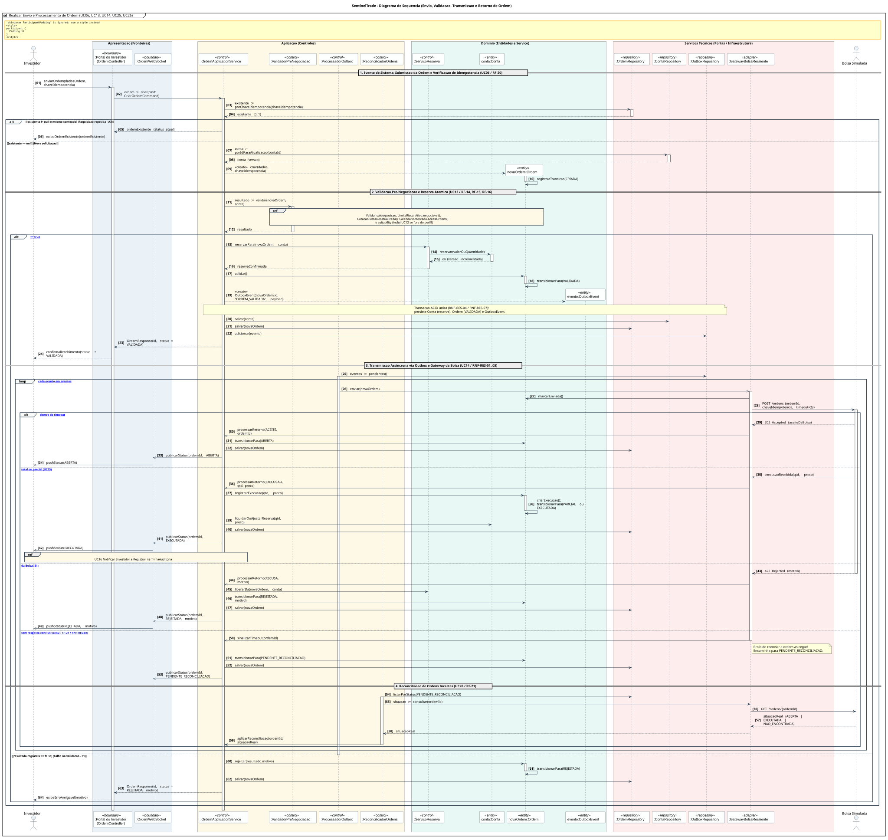
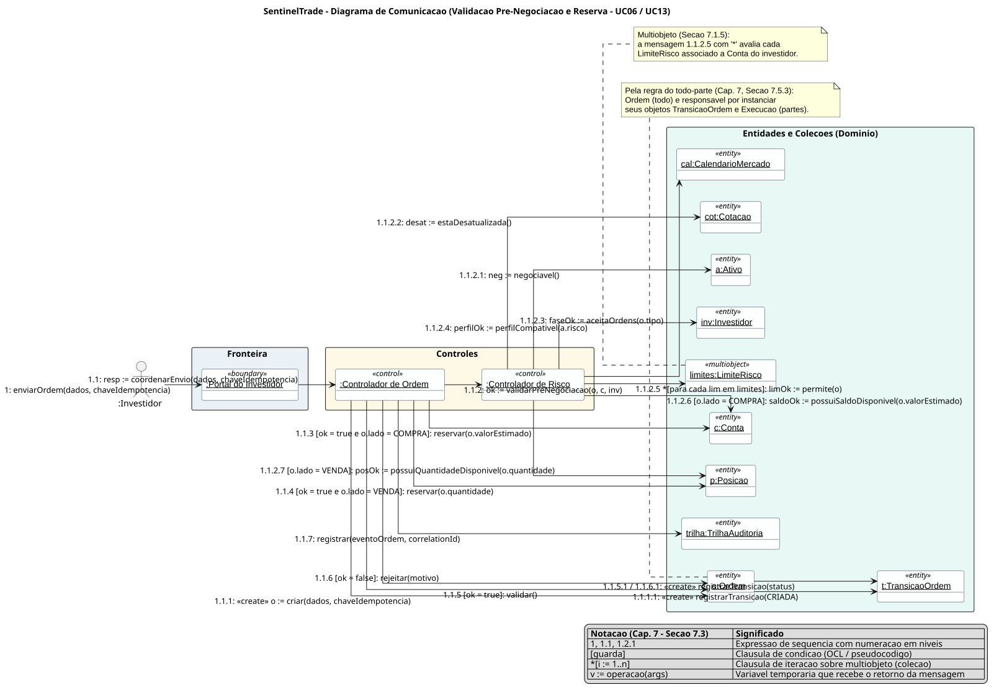

# Modelagem de Interações — SentinelTrade

> **Base:** `requisitos.md`, `uml-casos-de-uso.md`, `modelo-classes-analise.md` e `modelo-classes-projeto.md`.
>
> **Referência metodológica:** BEZERRA, Eduardo. *Princípios de Análise e Projeto de Sistemas com UML*, cap. 7, *Modelagem de interações*.
>
> **Arquivos dos diagramas (UML-as-a-Code):**
> - Diagrama de Sequência: `../extra-e-refs-aula/plantuml/interacoes-ordem.puml` (`../extra-e-refs-aula/assets/interacoes-ordem.svg`)
> - Diagrama de Comunicação: `../extra-e-refs-aula/plantuml/interacoes-comunicacao.puml` (`../extra-e-refs-aula/assets/interacoes-comunicacao.svg`)

---

## 1. Papel do Modelo de Interações

Conforme destacado no capítulo 7 (Bezerra), o modelo de casos de uso descreve **o que** o sistema faz sob a ótica externa dos atores, enquanto o modelo de classes fornece a visão **estrutural e estática**. O **modelo de interações** preenche a lacuna comportamental interna respondendo a quatro perguntas fundamentais:

1. Quais operações devem ser executadas internamente ao sistema para realizar um cenário de caso de uso?
2. A que classes essas operações pertencem (validando e refinando responsabilidades)?
3. Quais objetos participam da realização do cenário e em que ordem temporal trocam mensagens?
4. Que argumentos, valores de retorno, condições de guarda e iterações percorrem essas mensagens?

No SentinelTrade, a modelagem de interações concentra-se no **fluxo de maior criticidade e risco do negócio**: a submissão, validação pré-negociação, reserva atômica de recursos, publicação durável (*outbox*), transmissão resiliente à bolsa simulada, processamento de retorno e reconciliação de ordens incertas (**UC06**, **UC13**, **UC14**, **UC25** e **UC26**).

---

## 2. Diagrama de Sequência — Fluxo Crítico de Ordem

O diagrama de sequência prioriza a **ordem temporal** das mensagens (de cima para baixo) e a disposição horizontal recomendada na Seção 7.2.1: **Ator primário → Fronteiras (`«boundary»`) → Controles (`«control»`) → Entidades/Domínio (`«entity»`) → Portas/Adaptadores → Ator secundário**.

- Especificação PlantUML: [interacoes-ordem.puml](../extra-e-refs-aula/plantuml/interacoes-ordem.puml)



---

## 3. Diagrama de Comunicação — Validação Pré-Negociação e Reserva

Conforme a Seção 7.3 de Bezerra, o **diagrama de comunicação** é semanticamente equivalente ao diagrama de sequência, mas enfatiza as **ligações estruturais** (associações, composições e dependências) entre os objetos que colaboram para responder a um evento de sistema, utilizando **expressões de sequência aninhadas em níveis** (`1`, `1.1`, `1.1.2.1`, etc.).

- Especificação PlantUML: [interacoes-comunicacao.puml](../extra-e-refs-aula/plantuml/interacoes-comunicacao.puml)



---

## 4. Notação da UML 2.0 Utilizada (Cap. 7)

Cada mensagem obedece à sintaxe completa apresentada na Seção 7.1.1.2:

```text
[[expressao-sequencia] controle:] [v :=] nome [(argumentos)]
```

| Elemento da Notação | Representação nos Diagramas | Significado no SentinelTrade |
|---|---|---|
| **Evento de sistema e Operação de sistema** (Seção 7.5.4) | `enviarOrdem(...)` → `criar(cmd)` | Estímulo originado pelo `Investidor` na fronteira (`Portal do Investidor`) e recepcionado pelo controlador (`OrdemApplicationService`). |
| **Mensagem síncrona** (Seção 7.1.1.1) | Seta preenchida (`->`) | Usada na validação pré-negociação, reserva atômica e gravação ACID até o estado `VALIDADA` (garantindo resposta síncrona com p95 ≤ 300 ms — RNF-DES-01). |
| **Mensagem assíncrona** (Seção 7.1.1.1) | Seta aberta (`->>`) | Publicação via *outbox*/fila para o gateway da bolsa, chegada de execuções e envio de atualização por WebSocket (`OrdemWebSocket`). |
| **Mensagem de retorno e variável** (Seção 7.1.1.2.3) | Seta tracejada (`-->`) e `v := op()` | Variáveis temporárias (`existente`, `conta`, `resultado`, `situacao`) que condicionam guardas subsequentes. |
| **Mensagem reflexiva / auto-mensagem** (Seção 7.2.2) | Seta que sai e retorna à mesma linha de vida | `Ordem` invocando `transicionarPara(...)` (operação privada que protege a máquina de estados — RNF-SEG-04). |
| **Criação de objeto (`«create»`)** (Seção 7.2.4) | Seta tracejada apontando para a cabeça da linha de vida | Instanciação de `novaOrdem:Ordem` e `evento:OutboxEvent` no momento exato em que passam a existir na interação. |
| **Multiobjeto e Cláusula de iteração** (Seção 7.1.5) | `limites:LimiteRisco` com `*[para cada lim em limites]` | Avaliação iterativa de todos os limites operacionais associados à `Conta` do investidor (RF-14c, RF-30). |
| **Quadro `sd` e Ocorrência `ref`** (Seção 7.4.1) | `mainframe sd` e subquadros `ref` | Modularização da interação principal e referência às sub-interações de suitability (UC12), notificação (UC16) e auditoria (RF-28). |
| **Fragmentos combinados (`alt`, `loop`)** (Seção 7.4.1) | Quadros com pentágono `alt` e `loop` | Modelagem procedimental para idempotência (`[existente != null]`), aprovação/rejeição (`[regrasOk]`), consumo da *outbox* e desfechos da bolsa (aceite, execução, recusa ou *timeout*). |

---

## 5. Princípios de Projeto Aplicados na Interação (Seção 7.5)

### 5.1 Alta Coesão e Baixo Acoplamento (Seção 7.5.2 e 7.5.3 item 5)
Para evitar que o `Controlador de Ordem` (`OrdemApplicationService`) concentre toda a inteligência do sistema em uma colaboração excessivamente centralizada (*fork*), as responsabilidades foram distribuídas:
- **Coordenação da transação de caso de uso:** permanece em `OrdemApplicationService`.
- **Coordenação das regras pré-negociação:** delegada a `ValidadorPreNegociacao` (`Controlador de Risco`), que consulta `Ativo`, `Cotacao`, `CalendarioMercado`, `Investidor`, `LimiteRisco`, `Conta` e `Posicao`.
- **Invariantes financeiras e de estado:** permanecem nas próprias entidades (`Conta.reservar()`, `Posicao.reservar()`, `Ordem.validar()`, `Ordem.registrarExecucao()`).

### 5.2 Regra do Todo-Parte na Criação de Objetos (Seção 7.5.3 item 3)
Bezerra recomenda que, em relações de composição, o objeto **todo** tenha prioridade para instanciar suas **partes**. Por isso, quando `Ordem` muda de estado ou recebe uma execução parcial/total da bolsa, a própria instância de `Ordem` cria seus objetos compostos `TransicaoOrdem` e `Execucao`, preservando o encapsulamento do agregado.

### 5.3 Lei de Demeter — Princípio do Conhecimento Mínimo (Seção 7.5.3 item 7)
O controlador de ordem não navega na estrutura interna da carteira (`conta.getPosicoes().get(ativo).setBloqueado(...)`). Em vez disso, delega ao `ServicoReserva` e às operações de negócio de `Conta` e `Posicao`, reduzindo o acoplamento estrutural e respeitando RNF-SEG-04.

### 5.4 Fabricações Puras (*Pure Fabrications* — Seção 7.5.3 item 2)
Classes que não representam conceitos do domínio financeiro real — como `OrdemRepository`, `ContaRepository`, `OutboxRepository`, `ProcessadorOutbox`, `ReconcilicadorOrdens` e `GatewayBolsaResiliente` — foram introduzidas para lidar com persistência ACID, mensageria assíncrona e tolerância a falhas sem poluir as entidades `Ordem` e `Conta`.

---

## 6. Rastreabilidade com Casos de Uso e Requisitos

| Etapa / Fragmento da Interação | Casos de Uso | Requisitos Atendidos |
|---|---|---|
| Passo 1: Busca por `chaveIdempotencia` e bloco `alt [existente != null]` | UC06 (Fluxo A3) | RF-20, RNF-SEG-08, RNF-RES-03 |
| Passo 2: `ValidadorPreNegociacao` (ativo, frescor da cotação, fase do mercado, limites, suitability e saldo/posição) | UC06, UC12, UC13 | RF-10, RF-11, RF-14, RF-15, RF-30, RF-33 |
| Passo 2: `ServicoReserva.reservarPara()` + gravação ACID de `Conta`, `Ordem` e `OutboxEvent` | UC06, UC13 | RF-16, RNF-SEG-04, RNF-RES-04, RNF-RES-07, RNF-DES-01 |
| Passo 3: Consumo da *outbox* (`ProcessadorOutbox`) e envio com *timeout* de 2 s | UC14 | RNF-RES-01, RNF-RES-04, RNF-RES-06 |
| Passo 3 (`alt` Aceite / Execução / Recusa + `OrdemWebSocket`) | UC14, UC16, UC25 | RF-19, RF-23, RNF-DES-03 |
| Passo 3 e 4 (`alt` Timeout sem reenvio cego → `PENDENTE_RECONCILIACAO` → `ReconcilicadorOrdens`) | UC14 (E2), UC26 | RF-21, RNF-RES-02, RNF-INT-01 |
| Registro transversal em `TrilhaAuditoria` com `correlationId` | Todos | RF-28, RNF-AUD-01, RNF-RAS-01 |
